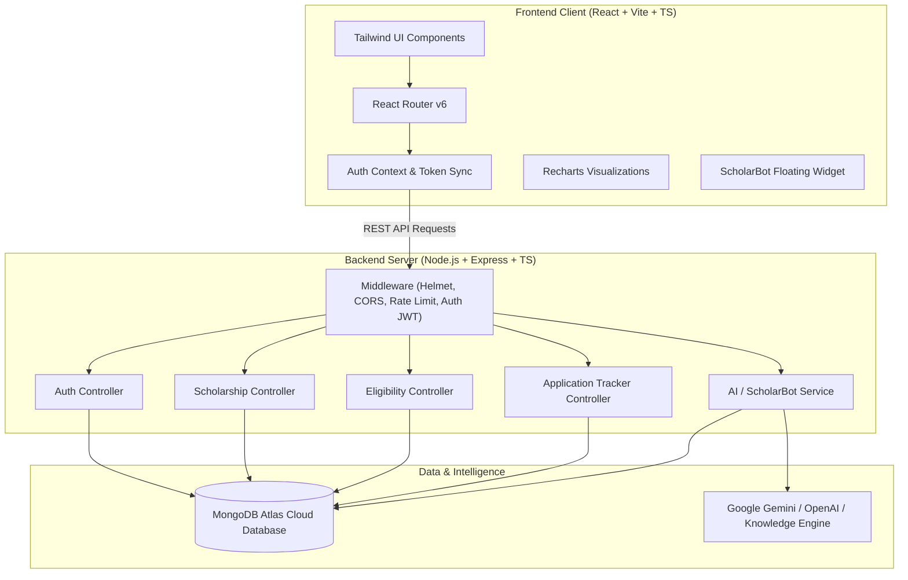

# 🎓 Scholar-Track

> **Modern Scholarship Discovery, Automated Eligibility Verification, and Student Assistance Platform**

Scholar-Track is a modern web application built from the ground up using **React, Vite, TypeScript, Tailwind CSS, Node.js, Express, and MongoDB Atlas**, augmented by **ScholarBot**—an intelligent scholarship assistant.

Designed as an educational capstone mini-project, Scholar-Track empowers students to discover authentic scholarships, verify criteria with rule-based precision, manage application deadlines across a 5-stage pipeline, and draft personalized application essays and checklists.

---

## 📋 Table of Contents
1. [Project Overview & Problem Statement](#-project-overview--problem-statement)
2. [Key Features](#-key-features)
3. [Technology Stack](#-technology-stack)
4. [System Architecture](#-system-architecture)
5. [Directory Structure](#-directory-structure)
6. [Database Schema & Models](#-database-schema--models)
7. [REST API Documentation](#-rest-api-documentation)
8. [Local Development & Windows Setup](#-local-development--windows-setup)
9. [Environment Configuration](#-environment-configuration)
10. [AI Integration & ScholarBot](#-ai-integration--scholarbot)
11. [Security Architecture](#-security-architecture)
12. [Cloud Deployment Guide (Render & MongoDB Atlas)](#-cloud-deployment-guide-render--mongodb-atlas)
13. [College Project Demonstration Guide](#-college-project-demonstration-guide)
14. [Limitations & Future Roadmap](#-limitations--future-roadmap)

---

## 🎯 Project Overview & Problem Statement

### The Problem
Every academic year, crores of rupees in government, philanthropic, and institutional educational aid remain unclaimed. Deserving students miss out on scholarships due to:
- **Fragmented Portals**: Information is scattered across dozens of central, state, and private websites.
- **Opaque Eligibility Rules**: Criteria regarding income thresholds, state domiciles, and percentage cutoffs are often difficult to interpret.
- **Missed Deadlines & Document Errors**: Strict document verification deadlines lead to rejection due to missing bonafide certificates or unlinked bank accounts.

### The Scholar-Track Solution
Scholar-Track provides:
1. **Centralized Scholarship Directory**: Searchable, filterable repository of verified schemes with direct official portal links.
2. **Rule-Based Eligibility Checker**: An objective comparison engine evaluating percentage, household income, domicile, and course level.
3. **5-Stage Application Tracker**: Personal student pipeline (*Interested*, *Planning to Apply*, *Applied*, *Documents Pending*, *Completed*).
4. **ScholarBot AI Assistant**: 24/7 advisor capable of answering scholarship questions, recommending schemes, and drafting Statement of Purpose (SOP) essays and email inquiries.

---

## 🌟 Key Features

### 1. Modern Responsive Landing Page
- Deep navy primary styling (`#0f172a`), indigo accents (`#4f46e5`), and emerald success metrics.
- Hero section with quick action buttons ("Explore Scholarships", "Check Eligibility", "1-Click Student Demo").
- Live metric statistics, handpicked featured scholarship cards, and step-by-step workflow guide.

### 2. Comprehensive Scholarship Directory (`/scholarships`)
- Real-time search across title, provider, description, and keywords.
- Dynamic multi-filters:
  - Education Level (High School, Diploma, Undergraduate, Postgraduate, Ph.D.)
  - Category (Merit-based, Need-based, Women in STEM, Minority, State Specific)
  - State Domicile (Pan-India, Maharashtra, Karnataka, Delhi, Tamil Nadu, etc.)
- Multi-criteria sorting (Highest Award Amount, Min Percentage, Title A-Z, Newest).
- Clear **Verified Scheme** vs. **Demonstration Record** badges.
- One-click bookmarking and direct addition to personal Application Tracker.

### 3. Rule-Based Eligibility Checker (`/eligibility`)
- Student credentials audit: Education level, academic score, family income, domicile state, and category.
- Compares student criteria against all database scholarship requirements.
- Tri-tier assessment results:
  - **100% Eligible**: All requirements satisfied.
  - **Partially Eligible (50% - 99%)**: Indicates exactly which 1-2 criteria are not met.
  - **Ineligible**: Explains exact disqualifying factors (e.g. income limit exceeded or score below cutoff).
- Preliminary evaluation disclaimer reminding students to check official portals.

### 4. Interactive Student Dashboard (`/dashboard`)
- **Analytics & Pipeline Charts (Recharts)**:
  - Donut chart displaying real-time application pipeline status breakdown.
  - Bar chart showing financial aid potential across tracked scholarships.
- **Application Tracker**:
  - Update status from dropdown (*Interested* → *Planning to Apply* → *Applied* → *Documents Pending* → *Completed*).
  - Add personal notes (e.g. "Sent attested documents via post on Oct 12").
  - Set custom target deadlines and delete tracked applications.
- **Saved Scholarships**: Shortlist bookmark manager with one-click portal links.
- **Profile Settings**: Update personal marks, state, and income for automated recommendations.

### 5. ScholarBot AI Assistant (`/scholarbot` & Floating Widget)
- Dedicated chatbot page and convenient slide-out floating widget across all pages.
- Grounded responses backed by MongoDB records to prevent hallucination.
- Dual-engine architecture:
  - **Generative Mode**: Connects to Google Gemini or OpenAI when an API key is configured.
  - **Intelligent Knowledge Engine**: Zero-cost, 100% reliable fallback answering FAQs, generating document checklists, and locating matching database scholarships even with no API key!
- Pre-populated prompt chips for one-click guidance.

### 6. AI Application Guidance Studio (`/guidance`)
- **Statement of Purpose (SOP) Drafter**: Structured 4-part essay outline customized to student's major and financial context.
- **Document Checklist Generator**: Stage-by-stage document collation guide.
- **Formal Application Email Drafter**: Professional inquiry templates to scholarship review committees.
- **Common Mistakes Guide**: Avoid Aadhaar seeding failures, expired income certificates, and last-minute server crashes.
- Copy-to-clipboard functionality and academic integrity notices.

---

## 💻 Technology Stack

| Layer | Technologies Used |
| :--- | :--- |
| **Frontend** | React 18, Vite, TypeScript, Tailwind CSS, React Router v6, Lucide React Icons, Recharts |
| **Backend** | Node.js (v18+ / v20+ / v24+), Express.js, TypeScript, RESTful architecture |
| **Database** | MongoDB Atlas, Mongoose ODM |
| **Authentication** | JSON Web Tokens (JWT), Bcrypt.js password hashing, HTTP-Only secure cookies |
| **Security & Middleware** | Helmet, CORS, Express-Rate-Limit, Zod schema validation, Centralized Error Handling |
| **AI Integration** | Google Gemini API / OpenAI API / Built-in Intelligent Rule & Knowledge Engine |
| **Deployment Target** | Render (Unified Single-Service Node.js deployment), MongoDB Atlas (Cloud DB) |

> 🚫 **Legacy Technologies Excluded**: No Java, Spring Boot, Maven, JSP, Python microservices, or C++ backends.

---

## 🏛️ System Architecture



---

## 📁 Directory Structure

```
Scholar-Track(new)/
├── client/                     # Frontend React SPA
│   ├── public/                 # Static assets
│   ├── src/
│   │   ├── components/
│   │   │   ├── common/         # Navbar, Footer, LoadingSpinner, ProtectedRoute
│   │   │   ├── dashboard/      # DashboardCharts, ApplicationTracker, ProfileSettings
│   │   │   ├── scholarship/    # ScholarshipCard, ScholarshipDetailModal
│   │   │   └── scholarbot/     # ScholarBotWidget
│   │   ├── context/            # AuthContext (state, login, demo accounts)
│   │   ├── pages/              # Home, Scholarships, Eligibility, Dashboard, ScholarBot, Guidance, Login, Register, About
│   │   ├── services/           # Typed REST API service methods
│   │   ├── types/              # Frontend TypeScript interfaces
│   │   ├── App.tsx             # Main router
│   │   ├── main.tsx            # Entry point
│   │   └── index.css           # Tailwind directives
│   ├── package.json
│   ├── tsconfig.json
│   └── vite.config.ts          # Vite proxy to backend
│
├── server/                     # Backend Express REST API
│   ├── src/
│   │   ├── config/             # MongoDB connection, safe database seeder
│   │   ├── controllers/        # Auth, Scholarship, Eligibility, Application, AI controllers
│   │   ├── middleware/         # Auth (JWT verification), Rate Limiting, Centralized Error Handler
│   │   ├── models/             # Mongoose schemas: User, Scholarship, SavedScholarship, Application
│   │   ├── routes/             # Express route declarations
│   │   ├── services/           # AIService (Gemini, OpenAI, Knowledge Engine)
│   │   ├── test/               # Automated smoke test suite
│   │   ├── types/              # Backend TypeScript types
│   │   ├── app.ts              # Express app setup, CORS, Helmet, static serving
│   │   └── server.ts           # Server bootstrap & port listener
│   ├── package.json
│   └── tsconfig.json
│
├── .gitignore                  # Git ignore (strict zero secret leakage)
├── .env.example                # Documented configuration template
├── package.json                # Root package for concurrent dev & build scripts
└── README.md                   # Full documentation & presentation guide
```

---

## 🗄️ Database Schema & Models

### 1. `User` Schema
- `name`: String (Required)
- `email`: String (Required, Unique, Lowercase)
- `passwordHash`: String (Bcrypt hashed, 10 rounds)
- `educationLevel`: String (Undergraduate, Postgraduate, etc.)
- `academicPercentage`: Number (0 - 100)
- `annualIncome`: Number (INR)
- `state`: String
- `category`: String (General, OBC, SC, ST, EWS, Minority)
- `gender`: String
- `timestamps`: CreatedAt, UpdatedAt

### 2. `Scholarship` Schema
- `title`: String (Indexed)
- `provider`: String
- `description`: String
- `awardAmount`: String
- `amountValue`: Number (for sorting/charts)
- `educationLevels`: Array of Strings
- `academicRequirements`: String
- `minPercentage`: Number
- `maxAnnualIncome`: Number (Optional)
- `applicableStates`: Array of Strings
- `categories`: Array of Strings
- `deadline`: String
- `officialUrl`: String (Verified link)
- `isVerified`: Boolean
- `isDemo`: Boolean
- `documentRequirements`: Array of Strings
- `tags`: Array of Strings
- `featured`: Boolean
- Text Index on `{ title, provider, description, tags }`

### 3. `SavedScholarship` Schema
- `userId`: ObjectId (Ref: User)
- `scholarshipId`: ObjectId (Ref: Scholarship)
- `savedAt`: Date
- Compound Unique Index: `{ userId: 1, scholarshipId: 1 }` (Prevents duplicate bookmarks)

### 4. `Application` Schema
- `userId`: ObjectId (Ref: User)
- `scholarshipId`: ObjectId (Ref: Scholarship)
- `status`: Enum (`'Interested'`, `'Planning to Apply'`, `'Applied'`, `'Documents Pending'`, `'Completed'`)
- `notes`: String
- `appliedDate`: Date
- `targetDeadline`: Date
- Compound Unique Index: `{ userId: 1, scholarshipId: 1 }`

---

## 🔌 REST API Documentation

### Authentication (`/api/auth`)
| Method | Endpoint | Description | Auth Required |
| :--- | :--- | :--- | :--- |
| `POST` | `/api/auth/register` | Register new student account | No |
| `POST` | `/api/auth/login` | Log in and receive JWT token + session cookie | No |
| `POST` | `/api/auth/logout` | Clear session cookie | No |
| `GET` | `/api/auth/me` | Fetch authenticated user profile | Yes (Bearer) |

### Scholarships (`/api/scholarships`)
| Method | Endpoint | Description | Query Parameters |
| :--- | :--- | :--- | :--- |
| `GET` | `/api/scholarships` | List scholarships with search and filters | `search`, `educationLevel`, `category`, `state`, `sortBy`, `page`, `limit` |
| `GET` | `/api/scholarships/:id` | Get scholarship details and related schemes | None |
| `GET` | `/api/scholarships/meta/filters` | Distinct filter values for categories and states | None |

### Eligibility Checker (`/api/eligibility`)
| Method | Endpoint | Description |
| :--- | :--- | :--- |
| `POST` | `/api/eligibility/check` | Evaluates student credentials against all scholarship rules |

### Student Dashboard & Application Tracking
| Method | Endpoint | Description | Auth Required |
| :--- | :--- | :--- | :--- |
| `GET` | `/api/applications` | Get tracked applications + status distribution | Yes |
| `POST` | `/api/applications` | Add scholarship to tracker | Yes |
| `PUT` | `/api/applications/:id` | Update status, notes, or target deadline | Yes |
| `DELETE` | `/api/applications/:id` | Remove scholarship from tracker | Yes |
| `GET` | `/api/saved-scholarships` | Get bookmarked scholarships | Yes |
| `POST` | `/api/saved-scholarships` | Bookmark a scholarship | Yes |
| `DELETE` | `/api/saved-scholarships/:id` | Remove bookmark | Yes |
| `GET` | `/api/profile` | Get current user profile | Yes |
| `PUT` | `/api/profile` | Update profile fields | Yes |

### AI Assistant & Guidance (`/api/ai`)
| Method | Endpoint | Description |
| :--- | :--- | :--- |
| `POST` | `/api/ai/chat` | Chat with ScholarBot (Generative or Knowledge Engine) |
| `POST` | `/api/ai/recommendations` | Rule-based and AI-explained recommendations |
| `POST` | `/api/ai/application-guidance` | Generate SOP draft, document checklist, or email |

### Health Check (`/api/health`)
| Method | Endpoint | Description |
| :--- | :--- | :--- |
| `GET` | `/api/health` | Uptime, database status, AI engine status |

---

## 🚀 Local Development & Windows Setup

### Prerequisites
- **Node.js**: v18.0.0 or later ([Download Node.js](https://nodejs.org/))
- **Git**: Installed
- **MongoDB**: Local MongoDB instance or free cloud cluster on [MongoDB Atlas](https://www.mongodb.com/atlas)

### Step 1: Clone or Open the Repository
```bash
cd "c:\Users\HP\Desktop\Mini-Project\Scholar-Track(new)"
```

### Step 2: Install Dependencies
Install dependencies for root, server, and client:
```bash
# In project root
npm run install:all
```
*(Or install in each directory individually: `npm install`, `cd server && npm install`, `cd ../client && npm install`)*

### Step 3: Configure Environment Variables
1. Copy `.env.example` to `server/.env`:
   ```bash
   cp .env.example server/.env
   ```
2. Open `server/.env` in VS Code and set:
   ```ini
   PORT=5000
   NODE_ENV=development
   CLIENT_URL=http://localhost:5173
   MONGODB_URI=mongodb+srv://<username>:<password>@cluster0.abcde.mongodb.net/scholar_track?retryWrites=true&w=majority
   JWT_SECRET=super_secret_scholar_track_key_at_least_32_characters_long_2026
   
   # Optional: Configure Gemini AI Studio key for generative ScholarBot responses
   # If left blank, ScholarBot automatically runs its built-in Intelligent Knowledge Engine!
   AI_PROVIDER=gemini
   GEMINI_API_KEY=your_gemini_api_key_here
   ```

### Step 4: Seed Initial Demonstration Scholarships
```bash
npm run seed
```
This safely populates 10+ verified and demonstration scholarships into your database.

### Step 5: Start the Development Server
Run frontend and backend simultaneously in one terminal:
```bash
npm run dev
```
- **Backend API**: `http://localhost:5000`
- **Frontend SPA**: `http://localhost:5173`
- **Health Endpoint**: `http://localhost:5000/api/health`

Open your web browser and navigate to: **`http://localhost:5173`**!

---

## 🔒 Security Architecture

In accordance with strict security standards:
1. **Zero Secret Leakage**: Real credentials, `.env` files, and private keys are excluded via `.gitignore`. The repository only includes `.env.example` with harmless placeholders.
2. **Password Protection**: Passwords are never stored in plaintext. They are salted and hashed using **Bcrypt.js** (10 salt rounds).
3. **Session Authentication**: Signed **JSON Web Tokens (JWT)** are transmitted via `Authorization: Bearer <token>` and `SameSite` HTTP-Only cookies.
4. **Input Validation**: All incoming requests are strictly validated using **Zod** schemas to prevent injection and malformed payloads.
5. **Security Headers & CORS**: Configured with **Helmet** to prevent clickjacking and XSS, with CORS restricted to approved origins.
6. **Rate Limiting**: Authentication (`/api/auth`) and AI chat (`/api/ai/chat`) routes are protected by IP rate limiters to defend against brute-force attacks and abuse.

---

## 🤖 AI Integration & ScholarBot

### Dual-Engine Capability
1. **Generative AI Mode (Google Gemini / OpenAI)**:
   - When a valid `GEMINI_API_KEY` is provided in `server/.env`, ScholarBot connects to Gemini 1.5 Flash.
   - Grounding: Database scholarship records are injected into the context window, ensuring the model references authentic amounts and portals rather than hallucinating.
2. **Built-in Intelligent Knowledge Engine (Zero-Cost Fallback)**:
   - When no external API key is provided, the platform **never breaks**.
   - ScholarBot falls back to an internal natural language intent router, database search, and structured response generator.
   - It answers questions regarding document checklists, SOP guidelines, and database search queries with 100% reliability and zero API expenses.

---

## ☁️ Cloud Deployment Guide (Render & MongoDB Atlas)

### Step 1: Set Up MongoDB Atlas
1. Sign up for free at [mongodb.com/atlas](https://www.mongodb.com/atlas).
2. Create a free **M0 Sandbox Cluster**.
3. Under **Database Access**, create a user (e.g. `scholar_admin`) and a strong password.
4. Under **Network Access**, add IP `0.0.0.0/0` (Allow Access from Anywhere) to permit Render connections.
5. Click **Connect** → **Drivers** and copy your connection string:
   `mongodb+srv://scholar_admin:<password>@cluster0.abcde.mongodb.net/scholar_track?retryWrites=true&w=majority`

### Step 2: Deploy to Render as a Unified Web Service
Render allows you to host both the React frontend and Express backend on a single free Node.js service!

1. Push your repository to **GitHub** (Ensure `.env` is NOT committed!).
2. Log into [Render.com](https://render.com) and click **New** → **Web Service**.
3. Connect your GitHub repository.
4. Configure service settings:
   - **Name**: `scholar-track`
   - **Environment**: `Node`
   - **Build Command**: `npm run install:all && npm run build`
   - **Start Command**: `npm run start`
5. Under **Environment Variables**, add:
   - `NODE_ENV`: `production`
   - `PORT`: `10000` (Render provides this automatically)
   - `MONGODB_URI`: *Your MongoDB Atlas connection string*
   - `JWT_SECRET`: *A random 64-character secret string*
   - `AI_PROVIDER`: `gemini` (or `fallback`)
   - `GEMINI_API_KEY`: *Your Google AI Studio key (optional)*
6. Click **Deploy Web Service**!
   Render will build the React SPA into `client/dist`, compile the Express server, and serve the application live on a public URL (e.g. `https://scholar-track.onrender.com`).

---

## 🎓 College Project Demonstration Guide

When presenting Scholar-Track to your teacher and evaluators, follow this recommended walkthrough:

### 1. Introduction & Problem Statement (1 Minute)
- Explain why the project was built: Deserving students miss out on scholarships due to scattered government portals, complex eligibility rules, and opaque deadlines.
- Scholar-Track brings discovery, rule-based matching, pipeline application tracking, and AI assistance into one beginner-friendly platform.

### 2. Live Platform Demonstration (4 Minutes)
1. **Homepage & 1-Click Demo Sign-In**:
   - Show the hero banner, real-time statistics, and handpicked featured scholarships.
   - Click the **"1-Click Student Demo"** button on the navbar to instantly authenticate as a demo student (`Alex Sharma`).
2. **Scholarship Directory (`/scholarships`)**:
   - Filter by Education Level (e.g. *Undergraduate*), Category (*Women in STEM*), or State (*Maharashtra*).
   - Point out the **Verified Scheme** vs **Demonstration Record** badges.
   - Click on a scholarship card to open the **Detail Modal**: show the grant amount, document checklist, and verified portal link.
   - Click **Save** and **Track Application**.
3. **Automated Eligibility Checker (`/eligibility`)**:
   - Demonstrate the rule-based assessment engine.
   - Enter student credentials (e.g. 82.5% marks, ₹3.5 Lakhs income, Undergraduate).
   - Click **Check Instant Eligibility** to reveal the tri-tier audit:
     - 100% Eligible matches
     - Partially Eligible matches with exact breakdown of missing criteria
     - Ineligible schemes with disqualification reasons
4. **Student Dashboard & Visual Analytics (`/dashboard`)**:
   - Show the Recharts Donut Chart illustrating the student's pipeline distribution (*Interested*, *Planning to Apply*, *Applied*, *Documents Pending*, *Completed*).
   - Change an application's pipeline status in real-time.
   - Add a custom personal note and view the financial aid bar chart.
5. **ScholarBot AI Assistant (`/scholarbot` & Floating Widget)**:
   - Click on the floating bottom-right **Ask ScholarBot** widget.
   - Ask: *"What documents are commonly required for state scholarships?"*
   - Notice the structured, formatted response referencing official criteria.
   - Explain the dual-engine design: Generative AI when an API key is available, and zero-cost Knowledge Engine fallback when offline.
6. **AI Guidance Studio (`/guidance`)**:
   - Showcase the 4 built-in tools: Statement of Purpose Outline generator, Document Checklist generator, Application Email drafter, and Common Mistakes guide.
   - Click **Copy Draft** and emphasize the academic integrity warning.

### 3. Architecture & Security Highlights (1 Minute)
- Highlight the modern TypeScript MERN architecture (no legacy Java/Maven complexity).
- Explain security precautions: Bcrypt salted password hashing, JWT session protection, rate limiting, and zero hardcoded secrets.

---

## 🔮 Limitations & Future Roadmap
- **SMS & Email Alerts**: Integrate Twilio or SendGrid to send reminder alerts 7 days before official scholarship closing dates.
- **OCR Document Scanner**: Allow students to upload marksheets and income certificates for automated OCR data extraction.
- **Institutional Admin Portal**: Enable college scholarship officers to verify bonafide certificates directly on the platform.

---

## 📜 License & Acknowledgments
Developed for academic demonstration and student empowerment. Sourced official scholarship information belongs to respective governmental and institutional bodies (Department of Higher Education, AICTE, Tata Trusts, Reliance Foundation).
